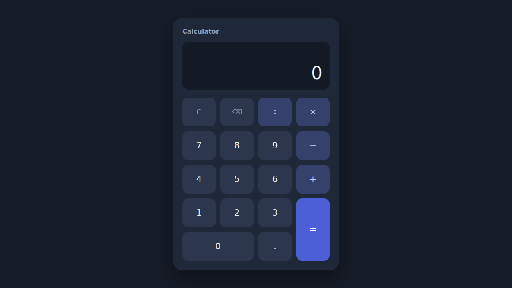
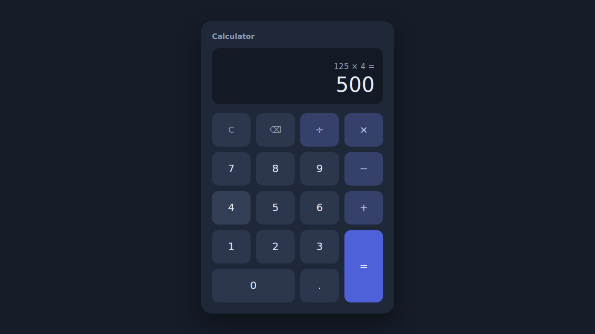
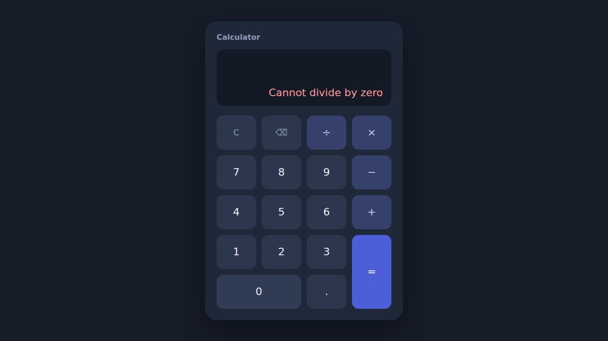
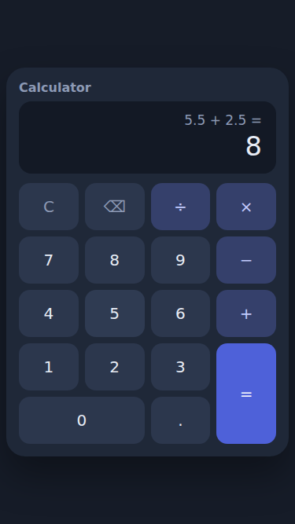

# Calculator — Oasis Infobyte Level 2

## Internship
- Program: AICTE Oasis Infobyte
- Track: Web Development and Designing
- Level: 2
- Task: 1 — Calculator
- Intern: Georvelain Dieuveil MIBANTESSA

## Project Overview
A responsive web calculator built with HTML5, CSS3 and vanilla JavaScript, with no framework and no CSS library.
It performs the four basic arithmetic operations, handles decimal numbers and chained operations, and reports errors
such as division by zero with a clear message instead of `Infinity` or `NaN`.

All calculations are written by hand in JavaScript (a `switch` on the operator). The code never uses `eval()`.

Design choices:
- Results are rounded to 12 significant digits, so `0.1 + 0.2` displays `0.3`.
- A number can contain at most 12 digits.
- Pressing `=` again repeats the last operation (`5 + 3 =` gives 8, then `=` gives 11).
- After a result, an operator continues with that result, while a digit starts a new calculation.
- `×` and `÷` have priority over `+` and `−`; the deferred part is shown in the expression line (`5 + 3 ×`).

## Features
- Display with a small expression line (above) and the result or error message (below)
- Digits `0-9` and a decimal point (only one per number)
- Addition, subtraction, multiplication and division
- `=`, `C` (clear all) and Backspace
- Sequential operations: `5 + 3 =` then `× 2 =` then `− 6 =` gives 10
- Chained operations without pressing `=`, with operator priority: `×` and `÷` are done before `+` and `−` (`5 + 3 × 2 =` gives 11)
- Consecutive operators: the last one pressed replaces the previous one
- Division by zero shows `Cannot divide by zero`; the calculator is usable again right after
- Keyboard support (enhancement): `0-9`, `.`, `+ - * /`, `Enter` or `=`, `Backspace`, `Esc`
- Responsive layout (desktop, tablet, phone in portrait and landscape)
- Accessibility: semantic HTML, `aria-label` on non-digit buttons, visible keyboard focus, `aria-live` result

## Technologies Used
- HTML5 (semantic elements)
- CSS3 (CSS Grid for the keypad, custom properties, media queries)
- JavaScript (vanilla, ES6)

## Project Structure
```text
WebDev-L2-Calculator/
├── index.html
├── css/
│   └── style.css
├── js/
│   └── script.js
├── screenshots/
└── README.md
```

## How to Run
No installation or build step is needed.

1. Download or clone the repository, then open the `WebDev-L2-Calculator/` folder.
2. Open `index.html` in a web browser (double-click it, or use an extension such as Live Server).

## Requirements Compliance
- [x] Display
- [x] Digits 0-9
- [x] Decimal point
- [x] Addition
- [x] Subtraction
- [x] Multiplication
- [x] Division
- [x] Equals button
- [x] Clear button
- [x] Backspace
- [x] Division by zero handling
- [x] Sequential operations
- [x] CSS Grid
- [x] JavaScript event listeners
- [x] No eval()
- [x] Responsive design
- [x] Keyboard support (enhancement)
- [x] Keyboard accessibility (`aria-label` on non-digit buttons, visible focus outline; checked programmatically, not with a screen reader)

## Testing
87 automated scenario checks were run in headless Chromium (Playwright) on the real page, with the browser console
monitored: **87 passed, 0 failed, no console error or warning**. The test script is not part of this repository.

| Area | Cases covered |
|---|---|
| Simple operations | `5 + 3 = 8`, `10 − 4 = 6`, `5 × 4 = 20`, `20 ÷ 5 = 4` |
| Decimals | `5.5 + 2.5 = 8`, `10.25 − 5.25 = 5`, `2.5 × 4 = 10`, `5.2.3` becomes `5.23`, `0.1 + 0.2 = 0.3`, `1 ÷ 3`, starting with `.` |
| Division by zero | `10 ÷ 0` and `0 ÷ 0` show the error message; no `NaN`/`Infinity`; digits, `.` and `C` recover |
| Reset / Backspace | `123 + 456` then `C` resets; `123` then Backspace gives `12`; Backspace on `0` |
| Sequential operations | `5 + 3 =`, `× 2 =`, `− 6 =` gives 10; chained operators; repeated `=`; new calculation after a result |
| Operator priority | `5 + 3 × 2 = 11`, `2 + 3 × 4 − 5 = 9`, `10 − 2 × 3 = 4`, `2 × 3 + 4 × 5 = 26`, errors inside a deferred operation |
| Edge cases | empty `=`, `0 + 0`, `0 × 10`, `10 ÷ 1`, negative results, leading zeros, 12-digit limit, very large result, 40 rapid clicks |
| Keyboard | all documented keys; `Enter` on a focused button does not trigger twice; letters and `Ctrl`+key are ignored |
| Responsive | no horizontal scroll and no vertical scroll (worst-case display) at 1920×1080, 1366×768, 768×1024, 375×667, 320×568 and 667×375; every button is at least 44 px high |

## Screenshots
Captured automatically from the running application.

**Desktop — main interface**



**Calculation in progress** (`125 ×` then `4`)


**Result** (`125 × 4 =`)



**Error handling** (`10 ÷ 0`)



**Mobile** (375 × 667, `5.5 + 2.5 =`)



## Future Improvements
- Sign toggle (`+/-`) to type negative numbers
- Percentage and square-root buttons
- History of recent calculations
- Light theme and theme switch
- Automatic font-size reduction for very long results
- Automated tests included in the repository

## Author
Georvelain Dieuveil MIBANTESSA — Web Development and Designing intern, AICTE Oasis Infobyte.
GitHub: [Georvain1972](https://github.com/Georvain1972)
