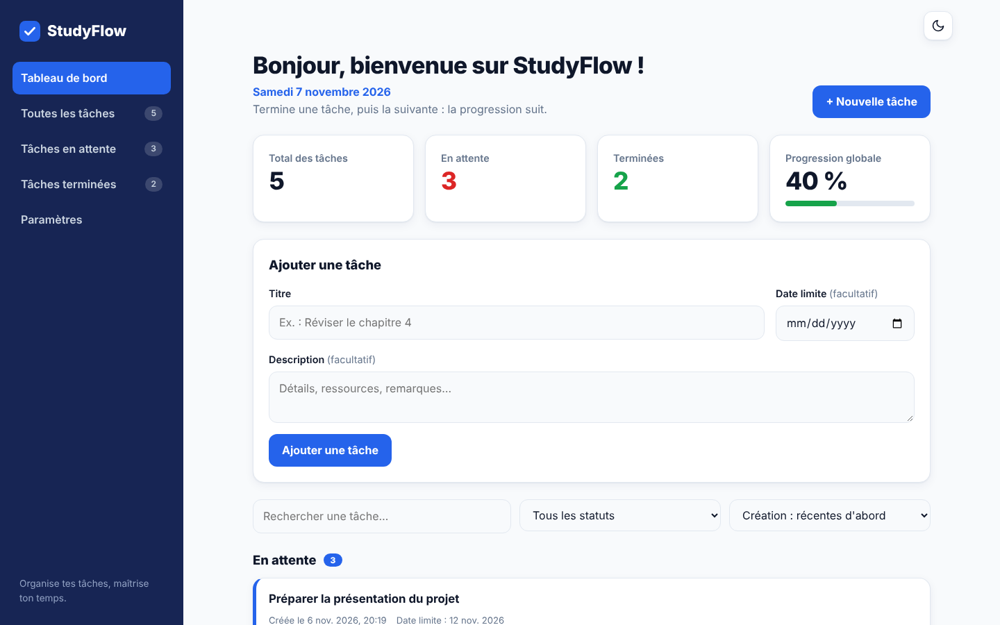

# StudyFlow – Smart To-Do App

> **Organise tes tâches, maîtrise ton temps.**

Application web de gestion des tâches destinée aux étudiants et aux jeunes professionnels. Elle permet d'organiser ses activités quotidiennes, de suivre les tâches en attente et de visualiser celles qui sont terminées.

## Contexte

Projet réalisé dans le cadre du stage **Oasis Infobyte Internship (OIBSIP)** – *Web Development and Designing*, **Level 2, Task 3**.

## Objectifs

- Concevoir une application complète en HTML5, CSS3 et JavaScript pur, sans framework ni backend.
- Proposer une interface moderne, accessible et responsive (ordinateur, tablette, smartphone).
- Conserver les données dans le navigateur grâce à LocalStorage.

## Fonctionnalités

**Gestion des tâches**
- Ajouter une tâche (titre obligatoire, description et date limite facultatives) ; les tâches vides sont refusées.
- Terminer, modifier, supprimer (avec confirmation) et remettre en attente une tâche.
- Déplacement automatique entre « En attente » et « Terminées », avec animation.
- Date de création et de réalisation affichées ; indicateur « En retard » pour les dates limites dépassées.

**Tableau de bord**
- Cartes statistiques : total, en attente, terminées, progression globale (%), mises à jour automatiquement.
- Message de bienvenue, date du jour, phrase motivante.

**Confort d'utilisation**
- Recherche, filtre par statut, tri par date de création ou date limite.
- Notifications visuelles après chaque action.
- Mode clair / mode sombre mémorisé.
- Sauvegarde et restauration automatiques via LocalStorage.
- Messages élégants lorsque les listes sont vides.
- Sidebar en menu hamburger sur mobile, navigation clavier, focus visible, respect de `prefers-reduced-motion`.

## Technologies utilisées

| Technologie | Usage |
|---|---|
| HTML5 | Structure sémantique, `<dialog>` pour les fenêtres modales |
| CSS3 | Variables, Grid/Flexbox, animations, thèmes clair/sombre |
| JavaScript (Vanilla) | Logique de l'application, DOM, événements |
| LocalStorage | Persistance des tâches et du thème |

## Structure des fichiers

```
WebDev-L2-TodoApp/
├── index.html
├── css/
│   └── style.css
├── js/
│   └── script.js
├── assets/
│   └── images/
├── screenshots/
└── README.md
```

## Lancer le projet

1. Télécharge ou clone le dépôt.
2. Ouvre `index.html` dans un navigateur récent (Chrome, Edge, Firefox, Safari).
3. Aucune installation n'est nécessaire. Avec VS Code, l'extension **Live Server** (clic droit > *Open with Live Server*) est pratique pour le développement.

## Captures d'écran

À ajouter dans le dossier `screenshots/` puis à référencer ici :

| Vue | Fichier |
|---|---|
| Tableau de bord (mode clair) | `screenshots/dashboard-light.png` |
| Tableau de bord (mode sombre) | `screenshots/dashboard-dark.png` |
| Version mobile | `screenshots/mobile.png` |

<!-- Exemple :  -->

## Auteur

**Georvelain Dieuveil MIBANTESSA**
Stagiaire – Oasis Infobyte Internship (OIBSIP), Web Development and Designing, Level 2, Task 3.
