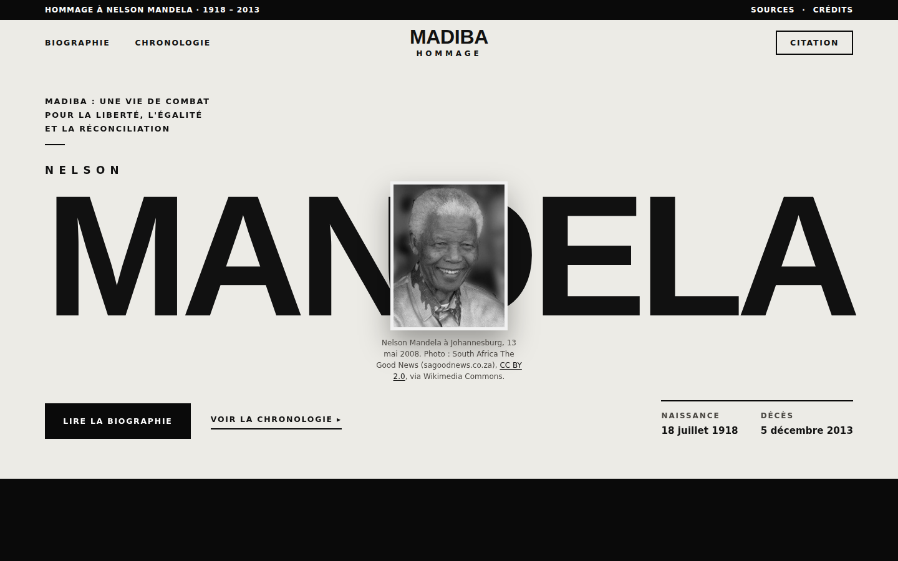
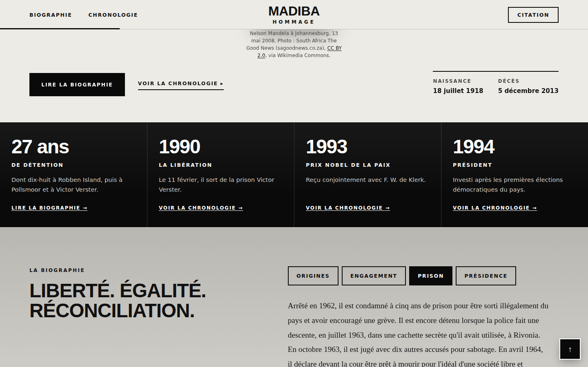
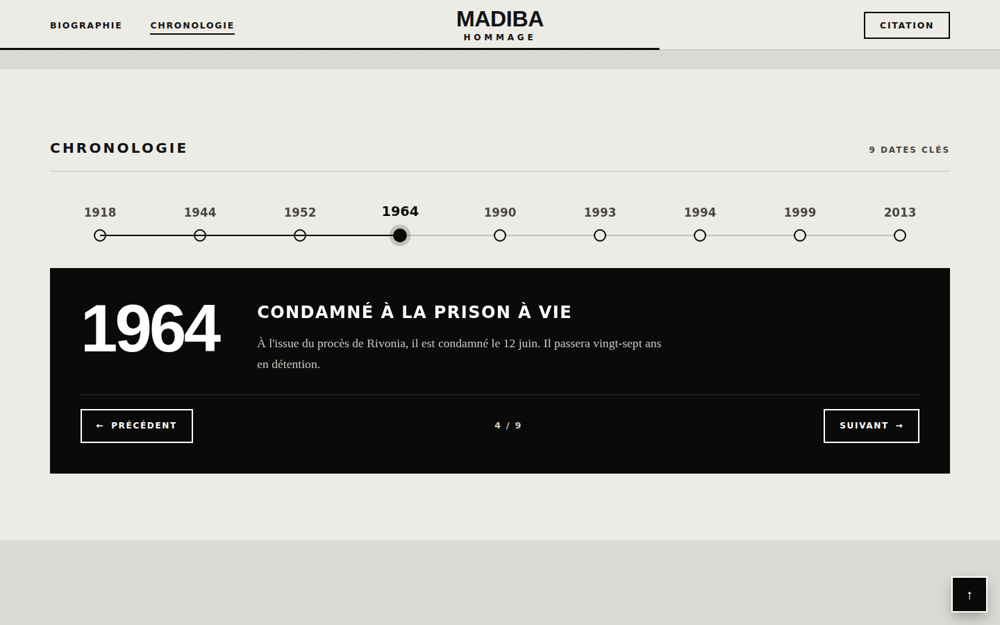
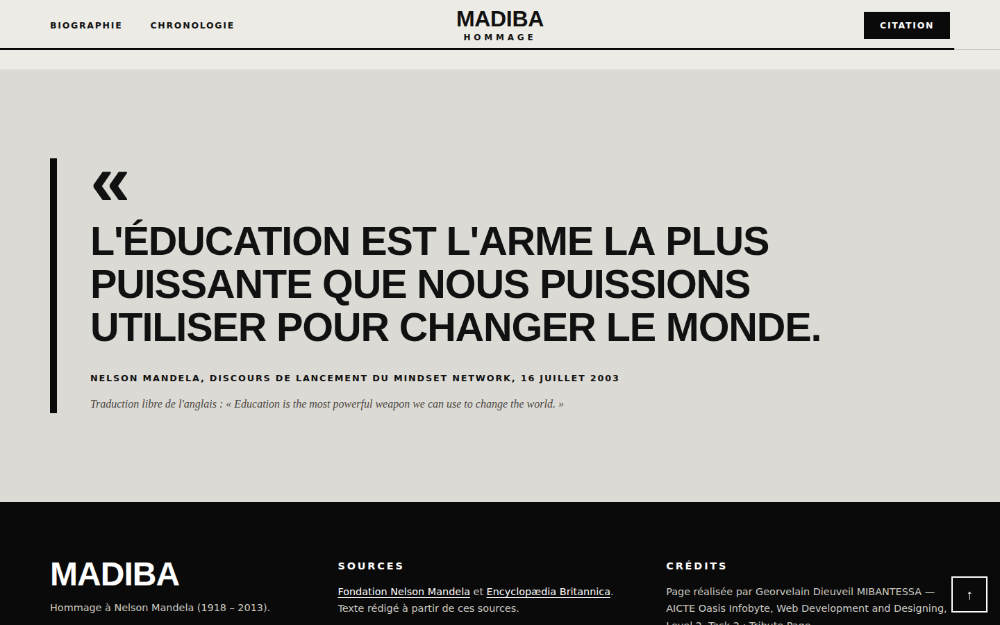
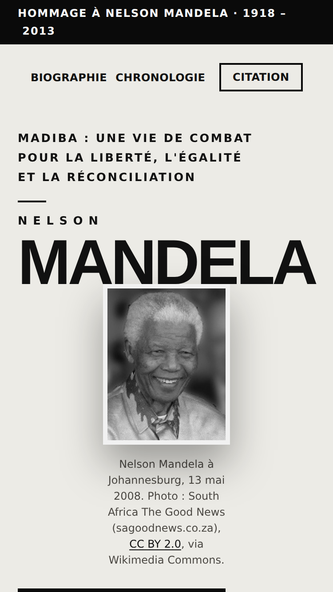
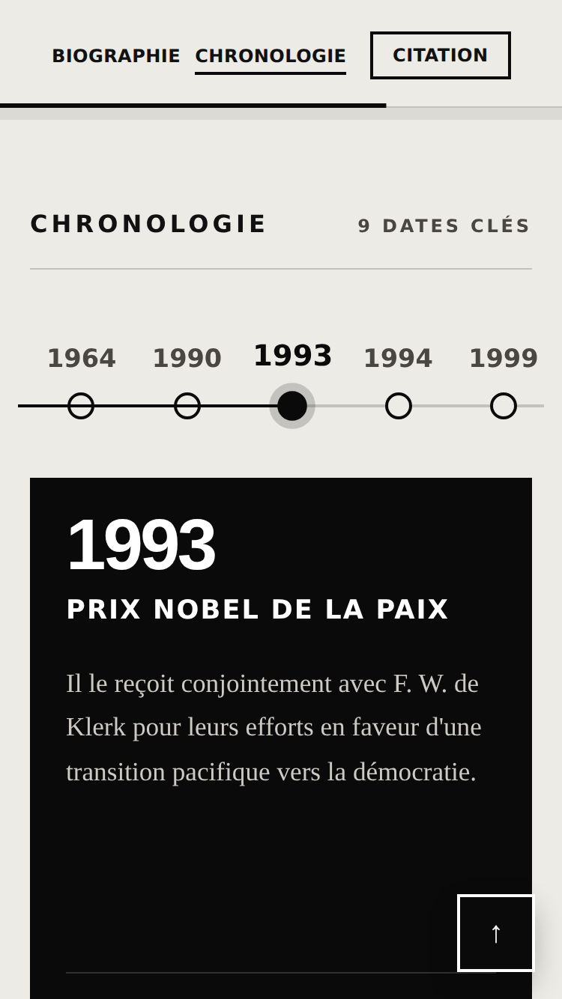

# Tribute Page — Nelson Mandela — Oasis Infobyte Level 2

## Internship
- Program: AICTE Oasis Infobyte
- Track: Web Development and Designing
- Level: 2
- Task: 2 — Tribute Page
- Intern: Georvelain Dieuveil MIBANTESSA

## Project Overview
A responsive tribute page dedicated to **Nelson Mandela** (1918–2013), written in French. It presents a short
biography, a timeline of key moments and a quote, built with HTML5, CSS3 and a small amount of vanilla JavaScript.

The text is written in my own words from the sources listed in *Credits and Sources*. The design is an editorial
black-and-off-white look inspired by a design mock-up I was given: a giant title with the portrait overlapping it, a black
strip of key facts, a grey biography band, black cards for the timeline and square corners. All colours are defined in
one place (the `:root` block of `css/style.css`).

The biography is filtered with tabs, and the timeline is a horizontal strip of dates: a click on a date shows its
details in a black card below, with Previous / Next buttons.

## Features
- Page title with the subject's name (a giant title that fits the screen width), a one-line tagline and his dates
- Black and white portrait overlapping the giant title, shown at (or below) its real size of 189 px to stay sharp, with a licence credit
- A black strip of 4 key facts (27 years of detention, 1990, 1993, 1994), all taken from the biography text
- Biography: 4 paragraphs, filtered with 4 tabs (Origines, Engagement, Prison, Présidence) on a grey band
- Timeline: an ordered list of 9 key dates (1918, 1944, 1952, 1964, 1990, 1993, 1994, 1999, 2013), shown as a horizontal strip of dates with a detail card (click a date, use the Previous / Next buttons or the arrow keys); without JavaScript it stays a vertical list with every detail visible
- Quote block on a light grey band with a thick black left border, giant capitals, its source and an English original
- Several background colours (off-white, black, grey band, light grey quote) and two font families (heavy sans-serif titles, serif texts)
- Responsive layout from 320 px wide phones to desktop screens
- JavaScript enhancements: header intro animation; biography tabs (mouse and keyboard); a horizontal timeline where a click on
  a date shows its card and the coloured line follows the chosen step (on a phone the strip scrolls and recentres the chosen date); the quote appearing word by word; paragraphs and
  steps fading in on scroll; a reading-progress bar; a menu that highlights the current section; a "back to top" button
- The page stays fully readable without JavaScript, and animations are disabled for users who ask for reduced motion
- Accessibility: semantic HTML, a skip link, descriptive `alt` text, visible keyboard focus, AA text contrast

## Technologies Used
- HTML5 (semantic elements)
- CSS3 (Grid, custom properties, media queries)
- JavaScript (vanilla, ES6): `IntersectionObserver`, scroll events and `requestAnimationFrame`
- No framework, no CSS library, no external font or script

## Project Structure
```text
WebDev-L2-TributePage/
├── index.html
├── css/
│   └── style.css
├── js/
│   └── script.js
├── images/
│   └── mandela.jpg
├── screenshots/
└── README.md
```

## How to Run
No installation or build step is needed.

1. Download or clone the repository, then open the `WebDev-L2-TributePage/` folder.
2. Open `index.html` in a web browser (double-click it, or use an extension such as Live Server).

## Requirements Compliance
Official Level 2 · Task 2 checklist:

- [x] Page title with the subject's name and a one-line tagline
- [x] A prominent image (royalty-free, from Wikimedia Commons)
- [x] A biography or tribute section of 3–4 paragraphs of written content
- [x] A timeline or key achievements section (ordered list)
- [x] A quote block, styled distinctly
- [x] At least 2 different background colours across sections
- [x] At least 2 font styles (serif headings, sans-serif body)
- [x] Responsive layout

Additional work:

- [x] JavaScript enhancements (biography tabs, clickable horizontal timeline, animated quote, scroll animations, progress bar, active menu, back-to-top button)
- [x] Keyboard accessibility (skip link, visible focus, back-to-top usable with the keyboard)

## Testing
112 automated checks (55 on the page structure, accessibility and responsive layout, 57 on the tabs and the timeline) were run in
headless Chromium (Playwright) on the real page, with the console and network monitored: **112 passed, 0 failed, no
console or network error**. The test script is not part of this repository.

| Area | Cases covered |
|---|---|
| Task card requirements | title and tagline, image loaded with `alt` and credit, 4 biography paragraphs, 9 timeline items with dates matching the plan, quote block and attribution, background colours, font families |
| Accessibility | `lang`, landmarks, heading structure, `alt` text, `rel="noopener"`, WCAG AA contrast on 30 text styles plus the tabs and timeline styles, smallest text 12 px |
| JavaScript | header intro, blocks hidden then revealed on scroll, quote split into words, timeline strip and detail card, menu following the sections, progress bar, back-to-top with a click and with `Enter` |
| Keyboard | the first `Tab` reaches the skip link, which jumps to the biography; visible focus outline |
| Without JavaScript / reduced motion | all content stays visible (also if `script.js` fails to load), no animation, the button stays hidden |
| Biography tabs | 4 tabs with ARIA roles above the text (title on the left on a large screen, one column on a phone), one visible paragraph at a time, no height jump between tabs, mouse and keyboard (arrows, `Home`, `End`) |
| Timeline | 9 dates on one horizontal line, `tablist`/`tab`/`tabpanel` roles, one visible card at a time, Previous / Next buttons, mouse and keyboard (arrows, `Home`, `End`), the coloured line stopping exactly at the chosen date, the strip scrolling and recentring on a phone, no height jump between cards, on a computer (1440×900) and a phone (375×667), for all 4 tabs × 9 steps (36 combinations); vertical list when JavaScript is off |
| Responsive | no horizontal scroll, nothing overflowing, and the image, giant title and menu inside the screen at 1920×1080, 1366×768, 768×1024, 375×667, 320×568 and 667×375 |

Defects found and fixed during testing: empty Previous / Next buttons on a phone and a large gap inside the detail card (both caught on screenshots), an opened timeline step staying hidden (transparent) when reached with the keyboard at the bottom of the screen, two teal texts slightly under the AA contrast ratio (the teal was darkened), the menu overflowing on a 320 px screen, and animated content staying hidden if `script.js` failed to load (a safety net now restores it).

## Screenshots
**Desktop — header with the giant title and the portrait**



**Desktop — key facts strip and biography with tabs**



**Desktop — horizontal timeline with its black detail card**



**Desktop — quote**



**Mobile (375 × 667) — header**



**Mobile — horizontal timeline (the strip scrolls)**



## Credits and Sources
- **Portrait**: "Nelson Mandela, 13 May 2008", photo by South Africa The Good News (sagoodnews.co.za),
  licensed [CC BY 2.0](https://creativecommons.org/licenses/by/2.0/), via Wikimedia Commons.
- **Text and dates**: written from the [Nelson Mandela Foundation](https://www.nelsonmandela.org/) and the
  [Encyclopædia Britannica](https://www.britannica.com/biography/Nelson-Mandela).
- **Quote**: Nelson Mandela, speech at the launch of the Mindset Network, 16 July 2003 (Nelson Mandela Foundation
  archive). The French version is a free translation.

## Future Improvements
- A higher-resolution portrait with `srcset` for sharper display on large screens
- An English version of the page with a language switch
- A dark/light theme switch
- A cut-out, high-resolution portrait (needs a freely licensed image) to match the mock-up even more closely
- Additional sections (his writings, a gallery of freely licensed images)
- Automated tests included in the repository

## Author
Georvelain Dieuveil MIBANTESSA — Web Development and Designing intern, AICTE Oasis Infobyte.
GitHub: [georvelaindev](https://github.com/georvelaindev)
